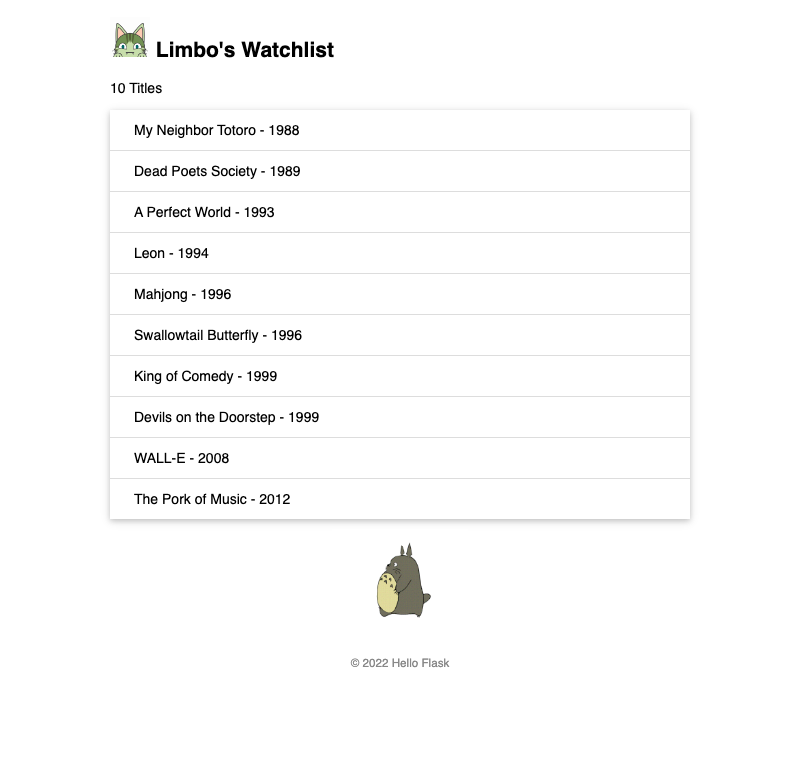

# limbo-movielist



A small Flask watchlist page from 2022. I was starting to learn web design, so I followed a Flask tutorial and kept the technology very simple: one Flask route, a Jinja template, one CSS file and a hard-coded list of movies (SQLAlchemy is set up but not used yet).

The code is kept as it was, rough early work. It shows where I started.

## Run it locally

```bash
pip install -r requirements.txt
python app.py
```

Then open http://127.0.0.1:5000 (on macOS, if port 5000 is taken by AirPlay Receiver, run it on another port, for example `flask run --port 5055`).
